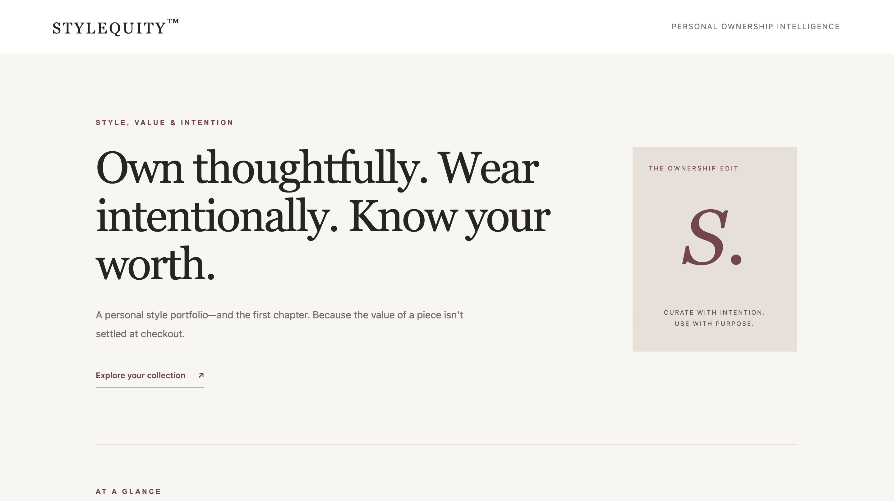
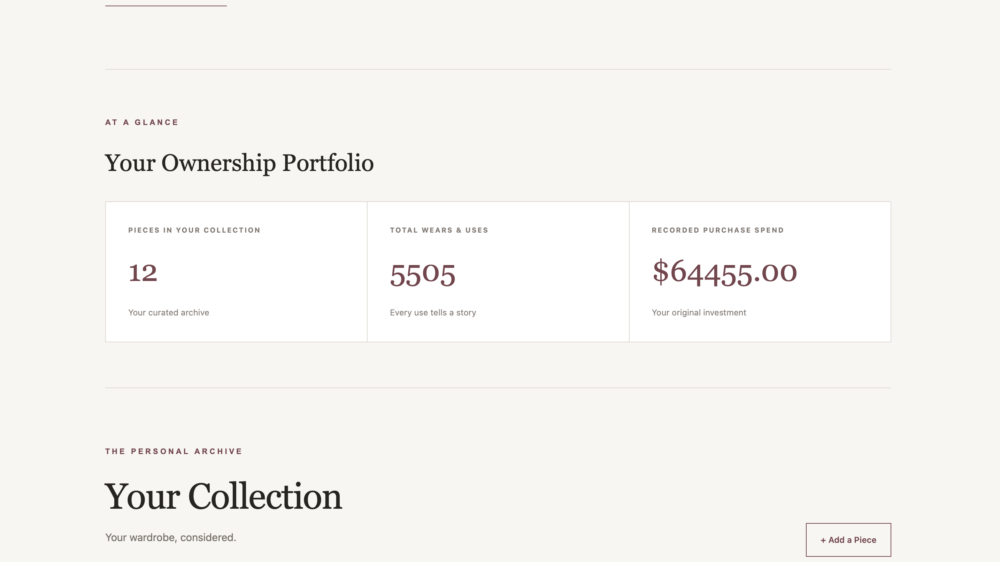
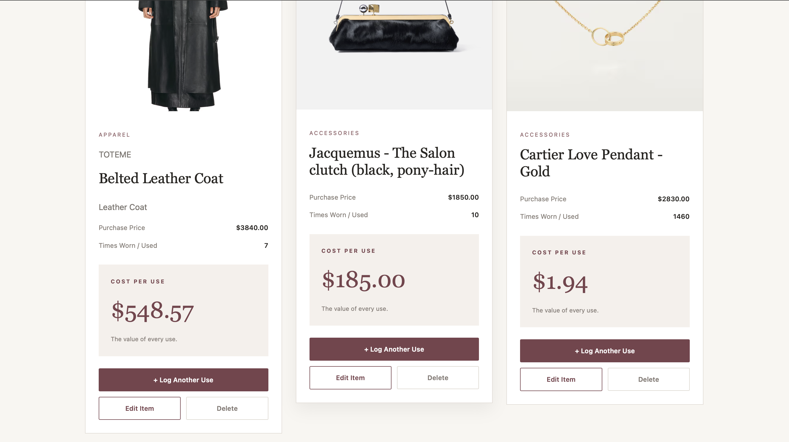
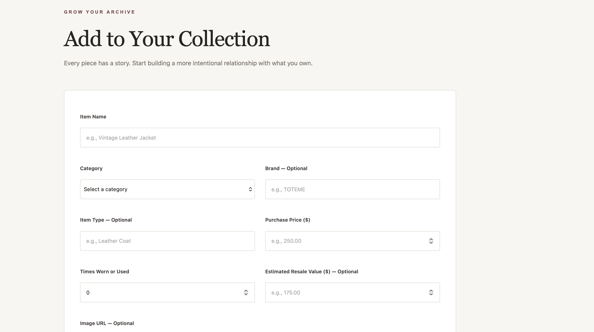

# STYLEQUITY™

### Your Personal Style Portfolio

**Own thoughtfully. Wear intentionally. Know your worth.**

Stylequity™ is a personal ownership intelligence platform designed to help people understand what they own, how they use it, and the value they receive from their purchases.

This full-stack application brings wardrobe, accessories, beauty devices, and home collections into a single, thoughtfully designed portfolio, making it easier to track usage, evaluate cost per use, and approach ownership with greater intention.

**[Explore the Live Application](https://stylequity.onrender.com/)**

---

## Overview

What if we approached our wardrobes and personal belongings as thoughtfully as we approach our financial portfolios?

Stylequity™ explores that question by bringing greater visibility to personal ownership.

Rather than simply cataloging possessions, the application helps users understand their purchasing decisions, track how frequently they use their belongings, and evaluate cost per use.

The goal is to encourage a more intentional relationship with consumption, ownership, and value.

## Application Preview

### Homepage



### Ownership Portfolio



### Collection Gallery



### Collection Management



## Features

### Personal Collection Management

- Add items to a personal collection.
- View belongings in a visual, card-based gallery.
- Edit existing item details.
- Delete items from the collection.
- Organize items across categories including apparel, footwear, accessories, furniture, home décor, and beauty devices.
- Record item details including category, brand, type, purchase price, usage count, estimated resale value, and an optional image URL.


### Ownership Insights

- View the total number of pieces in a collection.
- Track cumulative wears and uses.
- Monitor recorded purchase spending.
- Record optional estimated resale values.
- Calculate cost per use for individual items.

### Usage Tracking

Users can record additional wears or uses directly from an item's collection card.

Each recorded use updates the item's usage count and recalculates its cost per use.

### Persistent Data

Collection records are stored in MongoDB, allowing changes to remain available after page refreshes and across application sessions.

### Responsive Interface

Stylequity™ features an editorial-inspired interface designed to make collection management visually engaging and accessible across screen sizes.

## Understanding Cost Per Use

Cost per use provides a simple way to evaluate the value received from a purchase over time.

**Cost Per Use = Purchase Price ÷ Number of Uses**

For example, an item purchased for $200 and used 20 times has a cost per use of $10.

As the item receives additional use, its cost per use decreases.

Items that have not yet been used display a placeholder rather than a calculated value.

This metric is intended to support more informed ownership decisions—not to represent an item's resale value or investment return.

## Tech Stack

| Layer | Technologies |
|---|---|
| Frontend | HTML, CSS, JavaScript |
| Templating | EJS |
| Backend | Node.js, Express.js |
| Database | MongoDB Atlas |
| Database Integration | MongoDB Node.js Driver |
| Configuration | dotenv |
| Deployment | Render |
| Version Control | Git, GitHub |

## Getting Started

### Prerequisites

- Node.js and npm
- A MongoDB Atlas database
- Git

### Installation

**1. Clone the repository**

```bash
git clone https://github.com/BuilderPlayground/stylequity.git
```

**2. Navigate into the project directory**

```bash
cd stylequity
```

**3. Install dependencies**

```bash
npm install
```

**4. Configure environment variables**

Create a `.env` file in the project's root directory:

```env
MONGODB_URI=your_mongodb_connection_string
DB_NAME=stylequity
PORT=3000
```

Replace the placeholder with your own MongoDB connection string.

Ensure your MongoDB Atlas configuration permits connections from your development environment.

**Never commit your `.env` file or database credentials to GitHub.**

**5. Start the application**

```bash
node server.js
```

**6. Open the application**

Visit `http://localhost:3000` in your browser.

## Application Architecture

Stylequity™ uses Express.js to handle application routes and database operations, EJS to render dynamic pages, and MongoDB to persist collection records.

### Core Routes

| Method | Route | Function |
|---|---|---|
| GET | `/` | Display the collection and portfolio overview |
| POST | `/items` | Create a new collection item |
| GET | `/items/:id/edit` | Display an item's edit form |
| POST | `/items/:id/edit` | Save changes to an existing item |
| POST | `/items/:id/use` | Increment an item's usage count |
| POST | `/items/:id/delete` | Delete an item |

The application implements full CRUD functionality: Create, Read, Update, and Delete.

## Current Scope

Stylequity™ is a functional, publicly accessible prototype.

The current version uses a shared collection and does not include individual user accounts or authentication. Visitors can view and modify the same demonstration records.

**The live application should be used with demonstration data rather than private personal information.**

## Future Direction

Stylequity™ is an early exploration of a broader vision: making personal ownership more intentional, informed, and connected.

While the current application focuses on collection management and cost-per-use insights, future development may explore additional capabilities across personal style, shopping, community, and ownership intelligence.

Potential future directions include:

- Individual user accounts and private, personalized collections.
- Shopping wishlists and tools for more intentional purchase planning.
- Social discovery and community experiences centered on personal style, collections, and shared inspiration.
- Advanced collection filtering, organization, and search.
- Deeper spending, usage, and ownership analytics.
- Optional shopping and resale-market integrations.
- Historical value tracking and more comprehensive behavioral insights.

---

*Stylequity™ is an independent full-stack application exploring the intersection of ownership, consumption, personal style, and decision-making.*